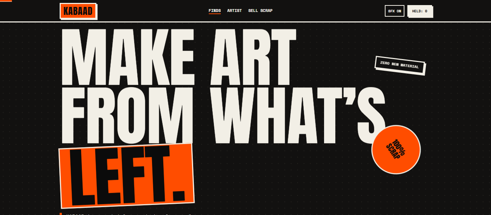
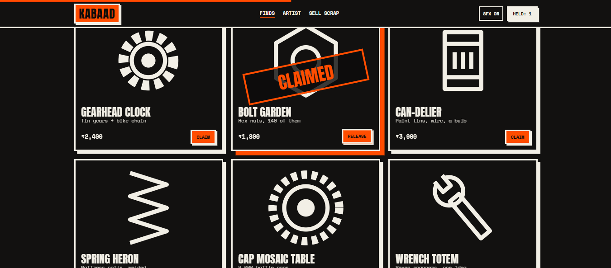
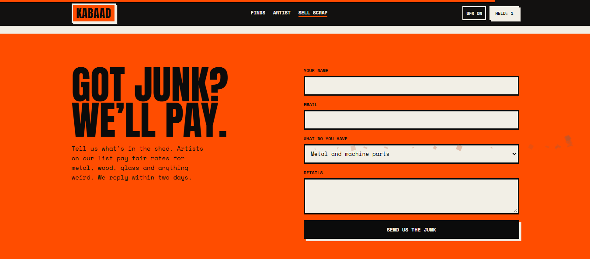
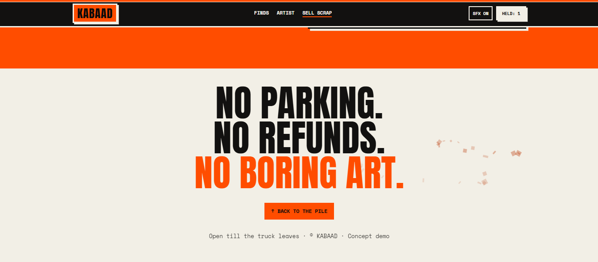

# KABAAD

A brutalist marketplace and zine for artists who turn scrap into art. It is loud and raw on purpose: thick black borders, hard offset shadows, giant condensed type and one safety-orange accent. It is a single `index.html` file with no build step.



## Features

- **Junk Shuffle.** One click (or the **S** key) re-collages the product grid with new sizes, tilts and colours, with a clattering metal sound.
- **Claim and hold list.** Claim a piece and it gets a stamped "CLAIMED" mark. A slide-in drawer lists your held pieces with a running total, and "Send enquiry" emails the list to you.
- **Price filters.** Chips for All, Under ₹3k, ₹3k–5k and ₹5k+.
- **Rust cursor trail.** Rust-coloured scrap marks follow the mouse and fade. It is off on touch devices and for reduced-motion visitors.
- **Smooth scroll.** Lenis inertial scrolling, a scroll progress bar, parallax on the headline and stickers, and a marquee band that slides with the scroll.
- **Count-up stats** that animate when they scroll into view.
- **Artwork in code.** Every product is drawn as inline SVG, so there are no image files.
- **Synthesized sound effects** (stamp, shuffle, clang, success) with a mute button. Nothing plays before the visitor's first interaction.
- **Light and dark modes** that follow the visitor's system setting.
- **Lead forms.** "Sell your scrap" and the hold-list enquiry both send to your email through FormSubmit, with a `mailto:` fallback.

## Screenshots

| | |
|---|---|
|  |  |
|  | |

## Run it

Open `index.html` in a browser, or serve the folder:

```bash
npx serve .
```

To deploy, drag the folder onto Vercel or Netlify. No configuration is needed.

## Make the forms send to your inbox

Both forms post to `https://formsubmit.co/ajax/YOUR_EMAIL`. Search `index.html` for `formsubmit.co` and `mailto:` and replace the email address with yours.

1. Deploy the site, or open the file locally.
2. Submit a form once.
3. Click the activation link FormSubmit emails to you.
4. From then on, every submission arrives as a table in your inbox.

If the request fails, the page opens a pre-filled `mailto:` draft so no lead is lost.

## Customise

| What | Where |
|---|---|
| Colours | CSS variables at the top of `<style>` (`--hot`, `--bg`, `--ink`, `--mid`, `--rust`) |
| Products | The `P` array in the script, and the `S` object for their SVG drawings |
| Stats | The `data-n` attributes in the `.stats` block |
| Fonts | Anton and Space Mono from Google Fonts |

## Tech

HTML, CSS, vanilla JavaScript, the Web Audio API, [Lenis](https://github.com/darkroomengineering/lenis) 1.1.13 (CDN) and Google Fonts.

## Accessibility

- Visible focus states, and the drawer closes with **Esc**.
- `prefers-reduced-motion` is respected, which disables smooth scroll, parallax, the cursor trail and animations.
- Sound only starts after a user gesture.

## Notes

This is a concept demo. The brand, artists, products, prices and stats are fictional.

## License

[MIT](LICENSE) © 2026 Manash Khati
